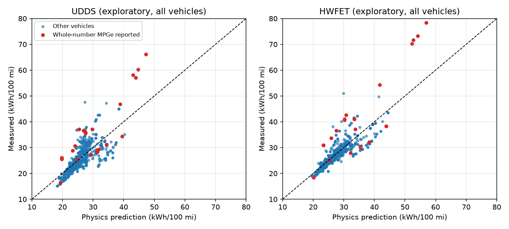
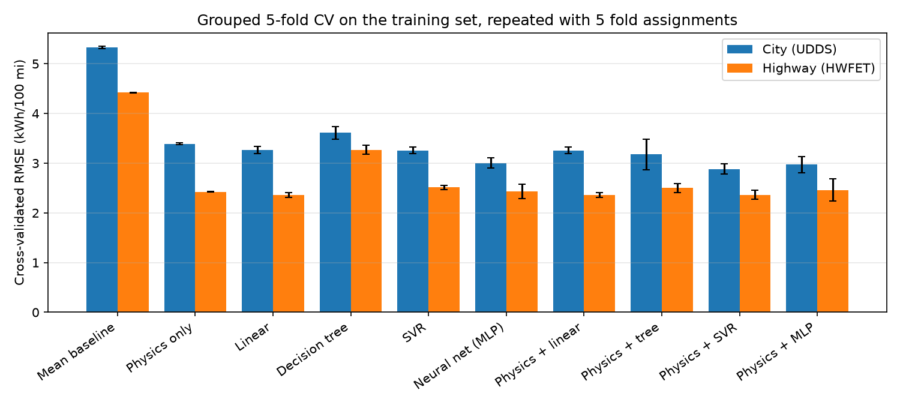
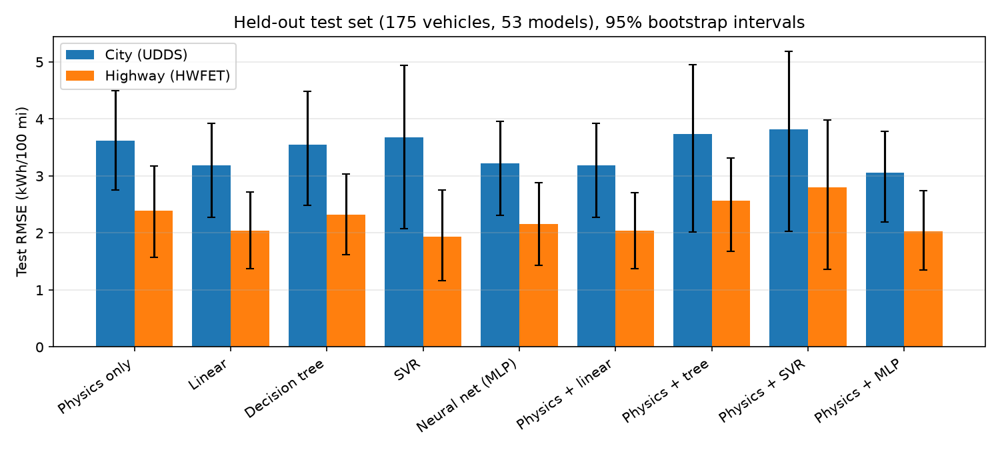
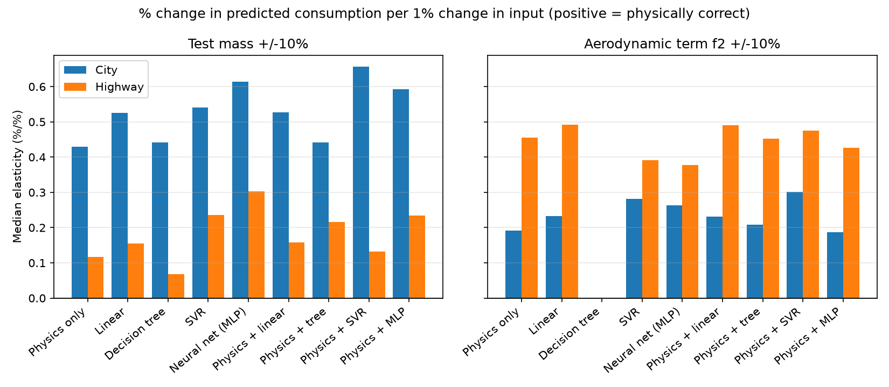
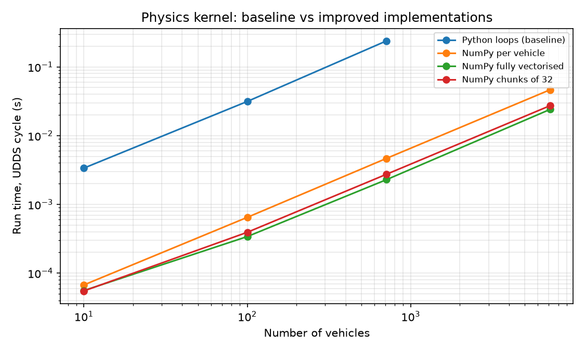

# EV Energy Consumption Prediction: Physics, Machine Learning and Hybrids

MMA3001 Numerical Methods and Machine Learning, Monash University, 2026.
Individual project by Harshil Dobariya.

## Summary

This project predicts how much energy a battery electric vehicle (EV) uses on the US EPA city (UDDS) and highway (HWFET) test cycles, from its design parameters: test mass, power, drivetrain and road-load coefficients. Energy consumption is the part of driving range that vehicle design controls, since range is approximately usable battery energy divided by consumption.

Three approaches are built and compared on 712 EVs from EPA test data (model years 2022 to 2026):

- a **physics model** that integrates road-load and inertia power over the measured drive-cycle speed traces, with three fitted physical parameters;
- **machine-learning models** from the unit (linear regression, decision tree, SVR, neural network);
- **hybrids**, where an ML model learns the physics model's error.

**Main finding.** The hybrid chosen by cross-validation (physics + SVR) did not beat physics alone on unseen vehicle models (test RMSE 3.82 vs 3.62 kWh/100 mi city), because it extrapolated badly for vehicles at the edge of the training data. The three-parameter physics model was the most robust: most stable across cross-validation folds, best at predicting new 2025 to 2026 models on the highway (RMSE 1.18 kWh/100 mi, R² 0.84), physically correct in its response to mass and drag for every vehicle, and about 260 times cheaper to train than the neural network.

## Contents

- [Engineering problem](#engineering-problem)
- [Inputs and outputs](#inputs-and-outputs)
- [Repository structure](#repository-structure)
- [Setup](#setup)
- [Reproducing the results](#reproducing-the-results)
- [Method and results by stage](#method-and-results-by-stage)
- [Validation and testing](#validation-and-testing)
- [Limitations](#limitations)
- [Documentation](#documentation)
- [AI use](#ai-use)
- [Data sources and licence](#data-sources-and-licence)
- [Project log](#project-log)

## Engineering problem

EV range depends on two things: battery capacity, which is a product decision, and energy consumption, which depends on the vehicle's mass, aerodynamics, rolling resistance and drivetrain efficiency. Predicting consumption from design parameters before a vehicle is built supports early design trade-offs, such as how much a 10% reduction in mass or drag would extend range.

The intended use is early-stage estimation and comparison of design options. It is not a replacement for physical testing. The scope is limited to the two EPA laboratory cycles, unadjusted (laboratory) consumption, and the vehicle parameters available in the EPA test data.

## Inputs and outputs

### Top-level inputs

| Input | Unit | Range in the data | Source |
|---|---|---|---|
| Equivalent test mass | kg (converted from lb) | 1,474 to 4,082 | EPA test car data |
| Rated power | hp | 98 to 1,839 | EPA test car data |
| Road-load coefficient A (mostly rolling resistance) | N (from lbf) | 74 to 295 | EPA test car data |
| Road-load coefficient B (speed-dependent losses) | N/(m/s) (from lbf/mph) | -2.6 to 13.7 | EPA test car data |
| Road-load coefficient C (mostly aerodynamic drag) | N/(m/s)² (from lbf/mph²) | 0.22 to 0.82 | EPA test car data |
| Drivetrain | category | 5 types, e.g. "All Wheel Drive" | EPA test car data |
| Vehicle type | category | Car, Truck, Both | EPA test car data |
| Drive-cycle speed traces | s, mph (1 s steps) | UDDS 1,369 s; HWFET 765 s | EPA drive schedules |

### Top-level outputs

| Output | Unit | Meaning and use |
|---|---|---|
| City consumption | kWh/100 mi | Predicted unadjusted energy from the wall per 100 miles on the UDDS |
| Highway consumption | kWh/100 mi | The same on the HWFET |
| Label MPGe (derived) | MPGe | Approximate window-sticker figure, about 0.7 × 3,370.5 / consumption |
| Label range (derived) | miles | Approximate EPA range, given a battery capacity and an assumed charging efficiency |

### Invalid, missing or unsupported inputs

- Efficiency values reported in mixed units (MPGe or kWh/100 mi) are converted by magnitude; placeholder values (for example 999) are removed.
- Placeholder horsepower values (below 50 hp) and rows with missing inputs are removed.
- Vehicles reported as whole-number MPGe on both cycles are excluded as suspected window-sticker values (confirmed against fueleconomy.gov).
- Physically implausible results (consumption outside 10 to 80 kWh/100 mi, or negative road load at 60 mph) are removed.
- Unseen drivetrain categories are encoded as all zeros instead of causing an error.
- Vehicles with any input outside the training data's 1st to 99th percentile range are flagged by `validation.out_of_domain`, because data-driven models extrapolate there.

Function-level inputs and outputs are documented in the docstrings and the HTML documentation.

## Repository structure

```
data/raw/            original EPA files, never edited by hand
data/processed/      cleaned data and split assignments (rebuilt by code, not committed)
src/ev_energy/       the project package (one module per stage)
scripts/             one script per stage, plus run_all.py
tests/               pytest tests
results/stage2..5/   figures and tables produced by each stage
reports/             test report and coverage report (HTML)
docs/                HTML documentation generated with pdoc
learning_log.md      record of each working session, including AI use
requirements.txt     package requirements
requirements-lock.txt  exact versions used for the reported results
```

## Setup

Requires Python 3.10 or later. The reported results were produced with Python 3.14.8 on macOS (Apple Silicon).

```bash
git clone <this repository>
cd <repository folder>
python3 -m venv .venv
source .venv/bin/activate          # Windows: .venv\Scripts\activate
pip install -r requirements.txt
pip install -e .
```

To reproduce the exact environment used for the reported results, use `pip install -r requirements-lock.txt` instead of `requirements.txt`.

## Reproducing the results

Run the whole pipeline, from raw data to documentation, with one command:

```bash
python scripts/run_all.py
```

This takes about 5 to 10 minutes. Add `--skip-performance` to leave out Stage 5, whose timings depend on the computer. All other results are identical on every run, because every random choice uses a fixed seed.

Each stage can also be run on its own:

| Stage | Command | Outputs |
|---|---|---|
| 1. Data cleaning | `python -m ev_energy.data_cleaning` | `data/processed/` |
| 2. Physics model | `python scripts/stage2_physics.py` | `results/stage2/` |
| 3. ML and hybrid models | `python scripts/stage3_models.py` | `results/stage3/` |
| 4. Test-set validation | `python scripts/stage4_validation.py` | `results/stage4/` |
| 5. Performance | `python scripts/stage5_performance.py` | `results/stage5/` |
| Tests | `pytest` | terminal |

## Method and results by stage

### Stage 1: data cleaning

21,479 raw rows were reduced to **712 vehicles (263 vehicle models)** with both a city and highway result. Key issues found in the raw data: the efficiency field mixes MPGe and kWh/100 mi between manufacturers; placeholder values (999 MPGe, 1 hp); inconsistent brand names; repeated tests of the same vehicle (median spread 0.16 kWh/100 mi, a measurement noise floor); and 28 vehicles whose values are window-sticker figures rather than test results.

### Stage 2: physics model

Wheel power is P = (m a + f0 + f1 v + f2 v²) v, with acceleration from central finite differences. Driving energy E+ and braking energy E- are integrated over each cycle with the trapezoidal rule. Wall energy is E = E+/η_d − η_r E- + P_aux T, which is linear in its three parameters, so they are fitted by bounded least squares.

- Fitted to all vehicles (exploratory): η_d = 0.796, η_r = 0.648, P_aux at its lower bound of 0 W.
- Verified against analytical solutions, EPA's published cycle distances (7.45 and 10.26 mi), a manufactured solution and energy conservation.
- Numerical error at EPA's 1 s time step: 1.0 to 1.4% (city) and 0.3% (highway), small compared with the model error of about 12%.



### Stage 3: ML and hybrid models

The data was split by vehicle model into 537 training vehicles (210 models) and 175 test vehicles (53 models), so no vehicle model appears in both. All tuning and model choice used grouped 5-fold cross-validation on the training set only, repeated over 5 fold assignments.

| Model | City CV RMSE | Highway CV RMSE |
|---|---|---|
| Physics only | 3.39 ± 0.01 | 2.43 ± <0.01 |
| Physics + SVR | 2.88 ± 0.10 | 2.36 ± 0.09 |
| Physics + linear | 3.26 ± 0.07 | 2.36 ± 0.05 |
| Neural network (MLP) | 3.00 ± 0.10 | 2.43 ± 0.14 |

(kWh/100 mi, mean ± standard deviation over 5 repeated runs.)

On the highway the top models differed by less than their run-to-run spread. The selection rule, fixed before opening the test set, chose one model for both cycles by lowest average RMSE: **physics + SVR**.



### Stage 4: test-set validation

The test set was used once, with no change to the model choice afterwards.

| Model | City test RMSE | Highway test RMSE |
|---|---|---|
| Physics only | 3.62 [2.75, 4.50] | 2.39 [1.58, 3.18] |
| Physics + SVR (selected) | 3.82 [2.03, 5.19] | 2.80 [1.36, 3.98] |
| Physics + MLP | 3.06 [2.20, 3.78] | 2.03 [1.35, 2.74] |
| Linear | 3.18 [2.27, 3.93] | 2.04 [1.38, 2.72] |

(kWh/100 mi, with 95% intervals from a bootstrap over vehicle models.)

- **Extrapolation:** the largest error was the 2025 Maserati Grecale Folgore, whose road-load inputs are at the edge of the training data. Physics predicted 31.7, physics + SVR 51.6, measured 26.9 kWh/100 mi.
- **Temporal check** (train on 2022 to 2024, test on 41 new 2025 to 2026 models): physics highway RMSE 1.18 (R² 0.84); physics + SVR R² −0.58.
- **Sensitivity** (±10% mass and drag): physics responded in the physically correct direction for every vehicle (mass elasticity 0.43 city, 0.12 highway; drag 0.19 city, 0.46 highway). Every flexible model gave wrong-direction responses for some vehicles, up to 33% of vehicles for physics + SVR.
- **Four well-known EVs** compared with official EPA figures: physics + SVR predicted 129.9 MPGe for the 2024 Tesla Model 3 RWD (official 132). Estimated range for the 2024 Hyundai Ioniq 6 Long Range RWD was 322 to 360 miles (EPA 361) and for the 2024 Kia EV6 Standard Range RWD 220 to 245 miles (EPA 232), for charging efficiencies of 95% to 85%.




### Stage 5: performance

- The physics kernel was implemented four ways with identical results (maximum relative difference 3 × 10⁻¹⁵). Vectorised NumPy was **104 times faster** than Python loops (0.0023 s vs 0.24 s for 712 vehicles).
- 10 FLOPs per vehicle per time sample; arithmetic intensity 0.06 FLOP/byte as written in NumPy and 0.63 for an ideal fused loop, so the kernel is **memory-bandwidth bound**.
- The fastest chunk size depends on the CPU cache: 32 vehicles on an Intel Xeon with a 1 MB L2 cache, about 712 on Apple Silicon. A chunk of 712 was chosen for the target machine: full speed, with memory capped at 23.7 MB instead of 234 MB for 7,120 vehicles.
- Profiling (`cProfile`): neural-network training takes about 80% of a cross-validation run.
- Physics trains in 0.7 ms against 181 ms for the neural network. Parallel tuning on 12 cores gave about a 2 times speed-up, limited by overhead on small fits.



## Validation and testing

- **154 automated tests**, covering 97% of the code. The test report is in `reports/test_report.html` and the coverage report in `reports/coverage/index.html`.
- Tests include analytical solutions (Simpson's rule exact for cubics, central differences exact for quadratics, measured convergence orders), EPA benchmark values, a manufactured solution for the physics fit, energy conservation, physically correct sensitivity, and a **leakage test** that corrupts held-out targets and checks predictions do not change.
- Results were reproduced on two machines (Intel Xeon with scikit-learn 1.8, Apple Silicon with scikit-learn 1.9). All results matched except the decision-tree models, which differed by up to 0.10 kWh/100 mi because of tie-breaking changes between library versions.

## Limitations

- **Missing inputs.** The best error (about 2.7 to 3.6 kWh/100 mi) is far above the measurement noise floor (0.16), because the data lacks inputs such as motor type, tyres and battery chemistry.
- **Constant efficiency.** The physics model assumes one drivetrain efficiency for all vehicles and speeds, so it underestimates the efficiency of the best vehicles by 5 to 13%.
- **Small test set.** With 53 test vehicle models, the 95% intervals are wide and no model is clearly better than physics.
- **Extrapolation.** Data-driven models are unreliable outside the training range; any use of a hybrid should check inputs with `out_of_domain` and fall back to physics.
- **Window-sticker exclusion.** The whole-number rule also removed about 10 vehicles that are probably genuine test results.
- **Range estimates** rely on published nominal battery capacity, an assumed charging efficiency and EPA's approximate 0.7 label adjustment.
- **Recommendation caveat.** The recommendation to prefer physics was informed by the test results, so its test performance can no longer be treated as an unbiased estimate.

## Documentation

HTML documentation of every module, function and class is generated from the docstrings with [pdoc](https://pdoc.dev) and saved in `docs/`. Open `docs/index.html` in a browser, or regenerate it with:

```bash
pdoc ev_energy -o docs --docformat numpy
```

Docstrings follow the NumPy style.

## AI use

Claude (Anthropic) was used throughout, for help in designing the workflow, writing majority of the code, tests and figures, and explaining concepts where there were gaps. All code was run and checked on my own machine, and the outputs were compared against expected values and against Claude's own runs. Claude's errors and corrections are recorded in `learning_log.md`, including an incorrect FLOP count and a chunk size that my own measurements overturned. Decisions on the project remained mine. Full disclosure and reflection are in the project report.

## Data sources and licence

- US EPA, [Data on Cars Used for Testing Fuel Economy](https://www.epa.gov/compliance-and-fuel-economy-data/data-cars-used-testing-fuel-economy), model years 2022 to 2026, downloaded October 2026.
- US EPA, [Dynamometer Drive Schedules](https://epa.gov/vehicle-and-fuel-emissions-testing/dynamometer-drive-schedules) (UDDS and HWFET).
- Official label figures from [fueleconomy.gov](https://www.fueleconomy.gov); battery capacities from manufacturer sources listed in `learning_log.md`.
- Kia America, 2024 EV6 pricing release (battery capacity 58.0 kWh and EPA range 232 miles for the EV6 Light RWD): https://kiamedia.com/us/en/models/ev6/2024
- Carscoops, 2024 Hyundai Ioniq 6 range figures (77.4 kWh battery, EPA range 361 miles for the Long Range RWD on 18-inch wheels): https://carscoops.com/?p=2601849

### MMA3001 unit notes
- Week 1: version control, documenting code, responsible use of AI, testing
- Week 2.1: optimisation and profiling (timing, profilers, FLOPs, memory bandwidth, arithmetic intensity, cache hierarchy)
- Week 2.2: numerical errors (round-off when comparing implementations)
- Week 3.4: spline interpolation (PCHIP used to refine the drive cycles without overshoot)
- Weeks 5.1 to 5.4: linear regression, decision trees, support-vector regression, neural networks
- Weeks 5.5 and 5.6: evaluating regression performance, training data evaluation and splitting
- Week 6: numerical integration (trapezoidal and Simpson's rules)
- Week 7.1: finite-difference derivatives

### Software documentation
- scikit-learn documentation (pipelines, GroupKFold, GridSearchCV, SVR, MLPRegressor): https://scikit-learn.org/stable/
- Python documentation, the Python profilers (cProfile): https://docs.python.org/3/library/profile.html
- Python documentation, tracemalloc (memory measurement): https://docs.python.org/3/library/tracemalloc.html
- NumPy documentation, legacy random generation (RandomState, used for reproducible folds): https://numpy.org/doc/stable/reference/random/legacy.html

The EPA data are published by the US Government as public data. The code is released under the MIT licence (see `LICENSE`).
